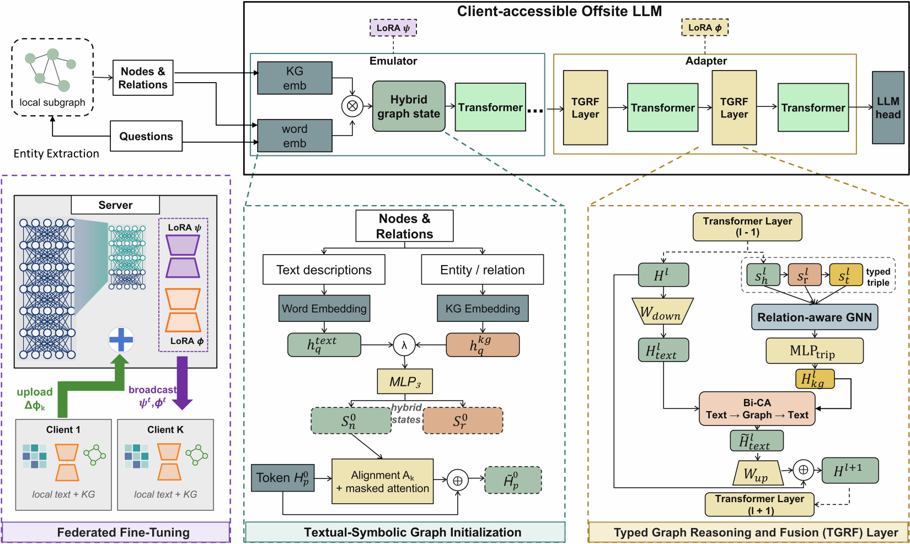

# FedSAKA

**FedSAKA** is a federated, structure-aware knowledge adaptation framework for offsite tuning of large language models. Each client uses its local text and evidence subgraphs to train knowledge-aware adapter components; the server aggregates trainable model state. The repository contains the implementation, experiment configurations, data preparation utilities, and evaluation scripts.

FedSAKA 是面向知识密集型问答的联邦大模型离线调优代码。客户端在本地结合文本与知识子图进行训练；仓库提供训练、数据处理和评测所需的源码与配置。



[Vector version of the architecture](figures/fedsaka_overall_framework.pdf)

## Method

FedSAKA combines hybrid entity and relation embeddings, relation-aware graph reasoning, triple representations, and token–graph fusion with an offsite LLM adapter. Local evidence graphs and examples stay with each client. The training code aggregates selected trainable parameters through the FederatedScope backend. This repository implements the research workflow; deployments requiring stronger privacy guarantees should add a suitable secure aggregation or differential privacy mechanism.

## Repository layout

| Path | Purpose |
| --- | --- |
| `federatedscope/llm/kg_adapter/` | Hybrid knowledge embeddings, graph reasoning, and adapter integration |
| `federatedscope/llm/` | LLM data loading, model building, offsite tuning, and training |
| `federatedscope/core/` | Federated training runtime |
| `fedsaka/experiments/` | IID, non-IID, and ablation configurations |
| `fedsaka/build_obqa_conceptnet_subgraphs.py` | OpenBookQA/ConceptNet graph preprocessing |
| `fedsaka/eval_kgqa_hit1.py`, `fedsaka/eval_kgqa_hit3.py` | KGQA evaluation |
| `fedsaka/eval_mcqa_acc.py` | Multiple-choice QA evaluation |
| `figures/` | Framework and experimental figures |
| `tests/` | Focused tests for adapter ablations, partition manifests, and evaluation |

## Installation

Use Python 3.9 or later and a CUDA-compatible PyTorch installation for Llama-2-7B training. Install the PyTorch and PyTorch Geometric wheels matching your CUDA runtime first, then install this package:

```bash
python -m pip install -e .
```

The default configurations use `meta-llama/Llama-2-7b-hf`, which requires access to the gated model on Hugging Face. Log in with your own account or override `model.type` with a local model path. The provided multi-GPU settings (`device`, `llm.model_parallel.max_memory`) must match your hardware.

## Data preparation

Dataset files and model weights are intentionally excluded from Git. Place datasets under `data/` with the paths expected by the configuration you run:

| Dataset | Example expected path | Configuration |
| --- | --- | --- |
| ComplexWebQuestions | `data/CWQ/ComplexWebQuestions_train.json` and `ComplexWebQuestions_dev.json` | `fedsaka/experiments/cwq/` |
| WebQSP alignment data | `data/WebQSP/data/WebQSP.train.json` and `WebQSP.test.json` | Used by offsite alignment |
| KQA Pro | `data/kqa_pro/train.json` and `val.json` | `fedsaka/experiments/kqapro/` |
| GraphQuestions | `data/GraphQuestions/graphquestions.training.json` and `graphquestions.testing.json` | `fedsaka/experiments/graphquestions/` |
| OpenBookQA + ConceptNet | Preprocessed `.pt` files under `data/` | `fedsaka/experiments/mcqa/` |

For OpenBookQA, build local ConceptNet subgraphs with `python -m fedsaka.build_obqa_conceptnet_subgraphs --help`. Point `--obqa-root`, `--conceptnet`, and `--model-path` at your licensed local copies. Do not commit datasets, model weights, generated checkpoints, or run logs.

The committed non-IID partition manifests in `fedsaka/experiments/noniid/manifests/` include source file hashes. Regenerate them using `python -m fedsaka.experiments.noniid.build_partition_manifests` when your dataset version differs; strict loading rejects mismatched source hashes.

## Training

Run commands from the repository root. For example, the CWQ IID experiment is:

```bash
python -m federatedscope.main --cfg fedsaka/experiments/cwq/cwq_client_iid_webqsp_align_kg_adpt2_dp2.yaml
```

For another model location, pass a command-line override after the configuration:

```bash
python -m federatedscope.main --cfg fedsaka/experiments/cwq/cwq_client_iid_webqsp_align_kg_adpt2_dp2.yaml model.type '/path/to/Llama-2-7b-hf@huggingface_llm'
```

The same directory contains the `dp5` and `hit3` variants. The KQA Pro and GraphQuestions directories have corresponding configurations. For OpenBookQA, use `fedsaka/experiments/mcqa/openbookqa_client_iid_webqsp_align_adpt2_dp2.yaml` after preparing the graph files. Non-IID runs use the configurations in `fedsaka/experiments/noniid/`.

To inspect the CWQ component ablation launcher without starting a full run:

```bash
python -m fedsaka.experiments.cwq.run_ablations --help
```

## Evaluation

Provide the checkpoint generated by your own run. The scripts expose full options through `--help`; a CWQ validation example is:

```bash
python -m fedsaka.eval_kgqa_hit1 --cfg fedsaka/experiments/cwq/cwq_client_iid_webqsp_align_kg_adpt2_dp2.yaml --dataset cwq --split val --ckpt checkpoints/your-checkpoint.ckpt
```

Use `fedsaka.eval_kgqa_hit3` for hit@3 and `fedsaka.eval_mcqa_acc` for OpenBookQA accuracy. KQA Pro's official test split lacks answer labels, so report labeled validation metrics rather than test hit@1.

## Figures and tests

The architecture appears above. The `figures/` directory also contains non-IID and robustness plots in PNG/PDF form. Run the focused CPU-side tests with:

```bash
python -m pip install -e '.[test]'
python -m pytest tests
```

Full Llama-2 training and evaluation additionally require the datasets, gated model weights, and GPU resources described above.

## License and upstream

Licensed under [Apache 2.0](LICENSE). The federated runtime and offsite tuning base are derived from [FederatedScope](https://github.com/alibaba/FederatedScope); the knowledge graph adapter and FedSAKA experiment code are organized here for this project. Retain upstream notices where applicable.
